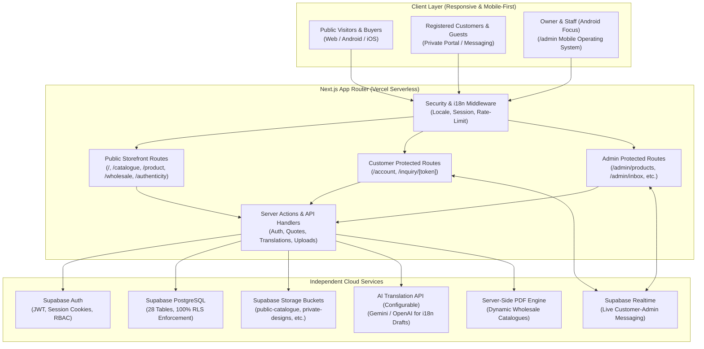
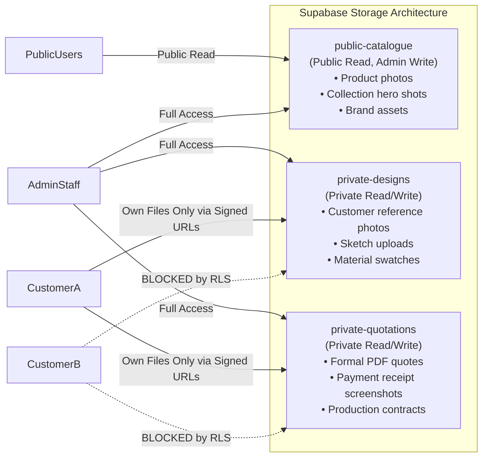
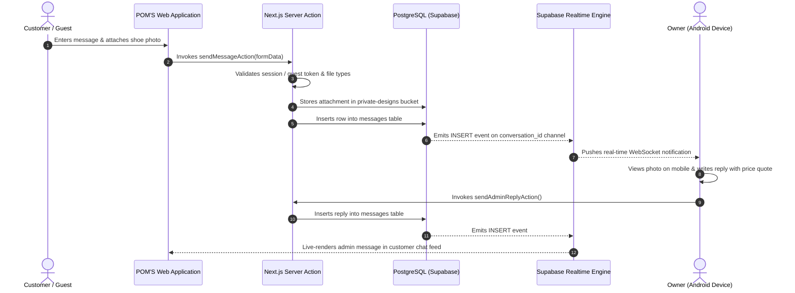

# POM'S Technical Architecture & System Design
**Document Version:** 1.0.0  
**Brand:** POM'S International Footwear  
**Project:** `POMS-WEBSITE`  
**Deployment Target:** Vercel (Production) + Supabase (PostgreSQL / Storage / Auth / Realtime)

---

## 1. System Topology & Technology Stack

POM'S is architected as a modern, unified full-stack application leveraging the Next.js App Router. It combines a high-performance public international storefront with a secure, mobile-first administrative operating system running on a single serverless deployment.

### 1.1 Core Technology Choices & Rationale
- **Framework: Next.js 15+ (App Router):** Provides React Server Components (RSC) for lightning-fast public catalogue rendering, streaming SSR for low-latency international delivery, and Server Actions for secure, form-based mutations without exposing API keys.
- **Language: TypeScript 5+:** Enforces compile-time type safety across database entities, form inputs, server actions, and localized dictionaries.
- **Styling: Tailwind CSS 4+:** Lightweight, high-velocity design system with custom CSS variables powering seamless transitions between Dark and Light luxury themes.
- **Database: PostgreSQL 16+ via Supabase:** Rock-solid relational data model with foreign keys, JSONB for dynamic metadata, triggers for audit trails, and native Row-Level Security (RLS).
- **Authentication: Supabase Auth + Server Cookies:** HttpOnly, Secure, SameSite cookies managed on the server via `@supabase/ssr`, preventing token theft via XSS.
- **Real-Time Communication: Supabase Realtime (WebSockets):** Enables live two-way customer messaging and immediate admin alerts without manual page polling.
- **Storage: Supabase Storage:** Segregated public CDN buckets for shoes and private signed-URL buckets for customer design sketches and payment proofs.

---

## 2. Public Storefront Architecture

The public storefront is designed for international elegance, lightning-fast product discovery, and effortless conversion into wholesale inquiries or bespoke shoe orders.

### 2.1 Route Map
- `/` — Dynamic luxury homepage with editable sections (Hero, Featured Lines, Craft Story, Custom Teaser, Wholesale Banner, Authenticity Badge).
- `/collection` & `/collection/[slug]` — Themed collections grouping seasonal models.
- `/catalogue` — Complete footwear directory featuring responsive 1-to-6 column layouts, instant client filtering, and full-text search.
- `/product/[slug]` — Deep-dive product specification with high-res zoomable gallery, wholesale specs (carton units, MOQ), related items, and quote request modal.
- `/custom-design` — Multi-step bespoke footwear studio allowing clients to upload reference pictures, specify leather/color, and open a direct dialogue.
- `/authenticity` — Instant database verification of QR codes and serial identifiers.
- `/wholesale` — Comprehensive export guide, B2B package inquiry form, and wholesale catalog request.
- `/size-guide` — Interactive shoe sizing matrix covering EU, UK, US, and Centimeter standards with model fit advice.
- `/shipping` — International trade terms, customs regulations, and freight guidelines.
- `/about`, `/contact`, `/faq`, `/privacy`, `/terms` — Brand narratives, support channels, compliance policies.

---

## 3. Mobile-First Admin Architecture (`/admin`)

Designed around the Android smartphone experience, allowing the business owner to conduct all operations on the go without requiring a laptop or desktop computer.

### 3.1 Mobile UX Principles
1. **Touch Ergonomics:** All touch targets maintain a minimum dimension of 48×48px. Essential controls are positioned within comfortable reach of the thumb.
2. **Camera & Gallery Integration:** Direct integration with Android native camera and photo picker for real-time shoe photography uploads.
3. **Responsive Drawers & Bottom Sheets:** Form fields, filter sheets, and action trays slide up from the bottom of the screen.
4. **Offline Resilience & Optimistic UI:** Form changes are preserved in local drafts to protect against intermittent mobile connectivity.

### 3.2 The 19 Administrative Subsystems
1. **Dashboard:** KPI summary (Active inquiries, pending quotes, in-production orders, unread messages).
2. **Homepage Editor:** Visual reordering of homepage sections with instant preview.
3. **Collection Manager:** Collection CRUD, cover photography, product association.
4. **Product Manager:** Catalogue CRUD, multiple image management, wholesale MOQ rules.
5. **Media Library:** Central media repository with Android camera upload, tagging, and safe-deletion verification.
6. **Custom Design Inquiries:** Visual queue of bespoke shoe requests with photo inspection.
7. **Customer Messages:** Multi-thread inbox with live messaging and photo replies.
8. **Customer Directory:** Master database of registered accounts and verified guest inquiries.
9. **Quotations Engine:** Line-item quote builder supporting 5 international currencies.
10. **Order Manager:** 10-stage order state machine tracking manufacturing and shipping.
11. **Translation Manager:** Multi-language editor with AI drafting and review workflows.
12. **Layout & Grid Controller:** Responsive column switcher (1–6 cols on desktop, 1–2 on phone) and card padding controls.
13. **Theme Settings:** Color palette tokens, contrast modes, and luxury accents.
14. **Wholesale Settings:** Standard packaging carton units, MOQ rules, export terms.
15. **Shipping Settings:** Destination rate tables, carrier preferences, lead times.
16. **SEO Manager:** OpenGraph images, meta descriptions, sitemap generator.
17. **Staff & Permissions:** Role-Based Access Control (RBAC) with granular privileges.
18. **Activity Logs:** Audit trail capturing every administrative edit, delete, and publish event.
19. **Website Settings:** Contact phone/WhatsApp, social links, announcement toggle.

---

## 4. Authentication & Authorization Design

### 4.1 Role-Based Access Control (RBAC)
Staff accounts are managed in the `staff_roles` and `profiles` tables. There is **no public registration** for administrative accounts. The initial owner account is provisioned via a protected server bootstrap script.

| Role | Permissions |
|---|---|
| `owner` / `super_admin` | Full system privileges, staff management, audit log access, financial settings. |
| `product_manager` | Full access to Products, Collections, Media Library, and Catalogue Layout. |
| `content_manager` | Full access to Homepage Editor, About/Brand pages, and Translations. |
| `wholesale_manager` | Access to Wholesale Inquiries, Quotations, and Order Management. |
| `customer_support` | Access to Custom Design Inquiries and Customer Messaging Inbox. |

### 4.2 Customer Authentication
- **Registered Customers:** Secure authentication using email and password or magic link OTP via Supabase Auth.
- **Guest Verification:** Guest buyers submitting inquiries receive a high-entropy cryptographically generated token (UUIDv4 + HMAC SHA-256). This token is stored in `guest_inquiries` and grants read/write access strictly to the matching conversation thread via `/inquiry/[token]`.

---

## 5. Storage Architecture & Privacy Segregation

POM'S employs distinct Supabase Storage buckets with explicit bucket-level security policies:

---

## 6. Real-Time Customer Messaging Architecture

---

## 7. Multi-Language & Dual-Theme Architecture

### 7.1 Internationalization (i18n) Engine
- Locales: `en` (English), `am` (Amharic), `so` (Somali), `zh-CN` (Simplified Chinese), `hi` (Hindi), `es` (Spanish).
- Next.js middleware detects user preference from cookie (`NEXT_LOCALE`) or browser `Accept-Language` header.
- Static UI strings are served from structured dictionaries (`/locales/{lang}.json`).
- Dynamic content (product titles, descriptions, collection overviews) is queried from relational translation tables (`product_translations`, `collection_translations`).
- AI translation engine provides automated first-draft translations into the 4 target languages, held in `draft` status until administrative review.

### 7.2 Universal Dual-Theme Engine
- The entire application uses semantic CSS custom properties defined in `globals.css`.
- The user's active theme is stored in `localStorage` and a persistent cookie (`poms_theme`), preventing hydration flash on reload.
- Light and Dark modes provide full contrast compliance across both public shopping experiences and dense administrative data tables.

---

## 8. Deployment & Operational Architecture

- **Hosting:** Vercel Global Edge Network with automatic CI/CD linked to GitHub repository `poms-international-website`.
- **Database:** Supabase Managed PostgreSQL with automatic daily backups and Point-In-Time Recovery (PITR).
- **Environment Isolation:** Zero connectivity to MSSQUEEN. Separate API keys, storage keys, and database connection pools.
