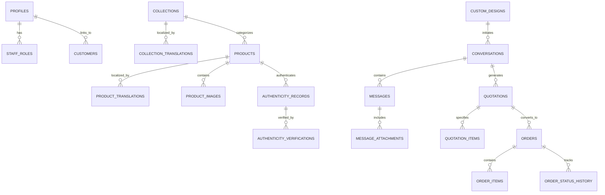

# POM'S Relational Database Schema & Security Policies
**Database Engine:** PostgreSQL 15+ (Supabase)  
**Security Level:** Enterprise / 100% Row Level Security (RLS) Enforced  
**Document Version:** 1.0.0

---

## 1. Schema Overview & Relational Architecture

The POM'S database comprises 28 structured tables designed for high performance, strict relational integrity, and total customer privacy.



---

## 2. Table Specifications & DDL

### 2.1 Identity, Users & RBAC

#### `profiles`
User profiles linking directly to Supabase Auth (`auth.users`).
```sql
CREATE TABLE public.profiles (
    id UUID PRIMARY KEY REFERENCES auth.users(id) ON DELETE CASCADE,
    email TEXT UNIQUE NOT NULL,
    full_name TEXT,
    phone TEXT,
    avatar_url TEXT,
    preferred_language VARCHAR(10) DEFAULT 'en',
    created_at TIMESTAMPTZ DEFAULT NOW(),
    updated_at TIMESTAMPTZ DEFAULT NOW()
);
```

#### `staff_roles`
Defines administrative permissions and roles.
```sql
CREATE TYPE public.app_role AS ENUM (
    'owner', 
    'super_admin', 
    'product_manager', 
    'content_manager', 
    'customer_support', 
    'wholesale_manager'
);

CREATE TABLE public.staff_roles (
    id UUID PRIMARY KEY DEFAULT gen_random_uuid(),
    profile_id UUID NOT NULL REFERENCES public.profiles(id) ON DELETE CASCADE,
    role public.app_role NOT NULL,
    active BOOLEAN DEFAULT TRUE,
    granted_by UUID REFERENCES public.profiles(id),
    granted_at TIMESTAMPTZ DEFAULT NOW(),
    UNIQUE(profile_id, role)
);
```

---

### 2.2 Product Catalogue & Collections

#### `collections`
Seasonal groupings and thematic edits.
```sql
CREATE TABLE public.collections (
    id UUID PRIMARY KEY DEFAULT gen_random_uuid(),
    slug TEXT UNIQUE NOT NULL,
    name TEXT NOT NULL,
    description TEXT,
    cover_image_url TEXT,
    display_order INT DEFAULT 0,
    is_featured BOOLEAN DEFAULT FALSE,
    is_published BOOLEAN DEFAULT TRUE,
    created_at TIMESTAMPTZ DEFAULT NOW(),
    updated_at TIMESTAMPTZ DEFAULT NOW()
);
```

#### `collection_translations`
Multilingual metadata for collections (English, Amharic, Chinese, Hindi, Spanish).
```sql
CREATE TABLE public.collection_translations (
    id UUID PRIMARY KEY DEFAULT gen_random_uuid(),
    collection_id UUID NOT NULL REFERENCES public.collections(id) ON DELETE CASCADE,
    language VARCHAR(10) NOT NULL, -- 'en', 'am', 'zh-CN', 'hi', 'es'
    name TEXT NOT NULL,
    description TEXT,
    meta_title TEXT,
    meta_description TEXT,
    is_reviewed BOOLEAN DEFAULT FALSE,
    created_at TIMESTAMPTZ DEFAULT NOW(),
    updated_at TIMESTAMPTZ DEFAULT NOW(),
    UNIQUE(collection_id, language)
);
```

#### `products`
Master footwear catalogue items.
```sql
CREATE TYPE public.shoe_type AS ENUM (
    'flat', 
    'heel', 
    'pump', 
    'slipper', 
    'slide', 
    'sandal', 
    'boot', 
    'bespoke'
);

CREATE TABLE public.products (
    id UUID PRIMARY KEY DEFAULT gen_random_uuid(),
    slug TEXT UNIQUE NOT NULL,
    name TEXT NOT NULL,
    collection_id UUID REFERENCES public.collections(id) ON DELETE SET NULL,
    shoe_type public.shoe_type DEFAULT 'flat',
    description TEXT,
    materials TEXT[], -- Array of primary materials (e.g. ['Calfskin Leather', 'Gold Studs'])
    colors TEXT[], -- Array of color variants (e.g. ['Noir Black', 'Champagne'])
    sizes_available TEXT[], -- Array of sizes (e.g. ['EU 36', 'EU 37', 'EU 38', 'EU 39', 'EU 40', 'EU 41'])
    base_price DECIMAL(10,2), -- Nullable for Price on Request
    currency VARCHAR(5) DEFAULT 'USD',
    is_price_on_request BOOLEAN DEFAULT TRUE,
    is_wholesale_available BOOLEAN DEFAULT TRUE,
    minimum_order_quantity INT DEFAULT 1,
    package_quantity INT DEFAULT 12, -- Shoes per standard export carton
    is_featured BOOLEAN DEFAULT FALSE,
    is_archived BOOLEAN DEFAULT FALSE,
    is_published BOOLEAN DEFAULT TRUE,
    display_order INT DEFAULT 0,
    created_at TIMESTAMPTZ DEFAULT NOW(),
    updated_at TIMESTAMPTZ DEFAULT NOW()
);
```

#### `product_images`
Multiple high-resolution images per shoe.
```sql
CREATE TABLE public.product_images (
    id UUID PRIMARY KEY DEFAULT gen_random_uuid(),
    product_id UUID NOT NULL REFERENCES public.products(id) ON DELETE CASCADE,
    image_url TEXT NOT NULL,
    alt_text TEXT,
    display_order INT DEFAULT 0,
    is_primary BOOLEAN DEFAULT FALSE,
    created_at TIMESTAMPTZ DEFAULT NOW()
);
```

#### `product_translations`
Multilingual product details.
```sql
CREATE TABLE public.product_translations (
    id UUID PRIMARY KEY DEFAULT gen_random_uuid(),
    product_id UUID NOT NULL REFERENCES public.products(id) ON DELETE CASCADE,
    language VARCHAR(10) NOT NULL, -- 'en', 'am', 'zh-CN', 'hi', 'es'
    name TEXT NOT NULL,
    description TEXT,
    materials_description TEXT,
    meta_title TEXT,
    meta_description TEXT,
    is_reviewed BOOLEAN DEFAULT FALSE,
    created_at TIMESTAMPTZ DEFAULT NOW(),
    updated_at TIMESTAMPTZ DEFAULT NOW(),
    UNIQUE(product_id, language)
);
```

---

### 2.3 Custom Shoe Design & Private Communication

#### `custom_designs`
Client-submitted bespoke footwear requests.
```sql
CREATE TABLE public.custom_designs (
    id UUID PRIMARY KEY DEFAULT gen_random_uuid(),
    reference_code VARCHAR(32) UNIQUE NOT NULL, -- e.g. 'POMS-CD-2026-8941'
    customer_profile_id UUID REFERENCES public.profiles(id) ON DELETE SET NULL,
    guest_name TEXT NOT NULL,
    guest_email TEXT,
    guest_phone TEXT NOT NULL,
    guest_country TEXT,
    design_description TEXT NOT NULL,
    material_preference TEXT,
    color_preference TEXT,
    preferred_contact_method VARCHAR(20) DEFAULT 'whatsapp',
    created_at TIMESTAMPTZ DEFAULT NOW(),
    updated_at TIMESTAMPTZ DEFAULT NOW()
);
```

#### `conversations`
Unified communication channel linking customer and administrator.
```sql
CREATE TYPE public.conversation_status AS ENUM (
    'open', 
    'pending_admin', 
    'pending_customer', 
    'quoted', 
    'confirmed', 
    'closed'
);

CREATE TABLE public.conversations (
    id UUID PRIMARY KEY DEFAULT gen_random_uuid(),
    custom_design_id UUID REFERENCES public.custom_designs(id) ON DELETE SET NULL,
    customer_profile_id UUID REFERENCES public.profiles(id) ON DELETE SET NULL,
    guest_access_token VARCHAR(64) UNIQUE, -- Unguessable token for verified guests
    title TEXT NOT NULL,
    status public.conversation_status DEFAULT 'open',
    created_at TIMESTAMPTZ DEFAULT NOW(),
    updated_at TIMESTAMPTZ DEFAULT NOW()
);
```

#### `messages`
Individual message records in a conversation thread.
```sql
CREATE TABLE public.messages (
    id UUID PRIMARY KEY DEFAULT gen_random_uuid(),
    conversation_id UUID NOT NULL REFERENCES public.conversations(id) ON DELETE CASCADE,
    sender_profile_id UUID REFERENCES public.profiles(id) ON DELETE SET NULL,
    is_from_admin BOOLEAN DEFAULT FALSE,
    content TEXT NOT NULL,
    translated_content TEXT, -- AI-assisted translation for smooth international trade
    is_read BOOLEAN DEFAULT FALSE,
    created_at TIMESTAMPTZ DEFAULT NOW()
);
```

#### `message_attachments`
Photos of designs, leather samples, and formal quotes attached to messages.
```sql
CREATE TABLE public.message_attachments (
    id UUID PRIMARY KEY DEFAULT gen_random_uuid(),
    message_id UUID NOT NULL REFERENCES public.messages(id) ON DELETE CASCADE,
    file_url TEXT NOT NULL,
    file_name TEXT NOT NULL,
    file_type VARCHAR(50) NOT NULL, -- 'image/jpeg', 'image/png', 'application/pdf'
    file_size_bytes BIGINT NOT NULL,
    created_at TIMESTAMPTZ DEFAULT NOW()
);
```

---

### 2.4 Quotations, Orders & B2B Wholesale

#### `quotations`
Formal business proposals issued by POM'S.
```sql
CREATE TYPE public.quotation_status AS ENUM (
    'draft', 
    'sent', 
    'accepted', 
    'revision_requested', 
    'declined', 
    'expired'
);

CREATE TABLE public.quotations (
    id UUID PRIMARY KEY DEFAULT gen_random_uuid(),
    quotation_number VARCHAR(32) UNIQUE NOT NULL, -- e.g. 'POM-Q-2026-0042'
    conversation_id UUID REFERENCES public.conversations(id) ON DELETE SET NULL,
    customer_profile_id UUID REFERENCES public.profiles(id) ON DELETE SET NULL,
    recipient_name TEXT NOT NULL,
    recipient_email TEXT,
    recipient_phone TEXT,
    recipient_country TEXT,
    currency VARCHAR(5) DEFAULT 'USD',
    subtotal_amount DECIMAL(12,2) NOT NULL,
    shipping_estimated_amount DECIMAL(12,2) DEFAULT 0.00,
    total_amount DECIMAL(12,2) NOT NULL,
    valid_until TIMESTAMPTZ NOT NULL,
    terms_and_conditions TEXT,
    status public.quotation_status DEFAULT 'sent',
    created_by UUID REFERENCES public.profiles(id),
    created_at TIMESTAMPTZ DEFAULT NOW(),
    updated_at TIMESTAMPTZ DEFAULT NOW()
);
```

#### `quotation_items`
Itemized line entries on a quotation.
```sql
CREATE TABLE public.quotation_items (
    id UUID PRIMARY KEY DEFAULT gen_random_uuid(),
    quotation_id UUID NOT NULL REFERENCES public.quotations(id) ON DELETE CASCADE,
    product_id UUID REFERENCES public.products(id) ON DELETE SET NULL,
    item_title TEXT NOT NULL,
    item_description TEXT,
    material_grade TEXT,
    color TEXT,
    size_breakdown TEXT,
    quantity INT NOT NULL,
    package_quantity INT DEFAULT 1,
    unit_price DECIMAL(10,2) NOT NULL,
    total_price DECIMAL(12,2) NOT NULL,
    created_at TIMESTAMPTZ DEFAULT NOW()
);
```

#### `orders`
Master order record resulting from an accepted quote or wholesale contract.
```sql
CREATE TYPE public.order_stage AS ENUM (
    'new_request', 
    'under_discussion', 
    'price_sent', 
    'awaiting_confirmation', 
    'confirmed', 
    'in_production', 
    'ready', 
    'shipped', 
    'completed', 
    'cancelled'
);

CREATE TABLE public.orders (
    id UUID PRIMARY KEY DEFAULT gen_random_uuid(),
    order_number VARCHAR(32) UNIQUE NOT NULL, -- e.g. 'POM-ORD-2026-018'
    quotation_id UUID REFERENCES public.quotations(id) ON DELETE SET NULL,
    customer_profile_id UUID REFERENCES public.profiles(id) ON DELETE SET NULL,
    stage public.order_stage DEFAULT 'confirmed',
    total_amount DECIMAL(12,2) NOT NULL,
    deposit_required_percent DECIMAL(5,2) DEFAULT 50.00,
    deposit_amount_paid DECIMAL(12,2) DEFAULT 0.00,
    is_deposit_verified BOOLEAN DEFAULT FALSE,
    payment_proof_url TEXT,
    shipping_address TEXT,
    destination_country TEXT,
    tracking_carrier TEXT,
    tracking_reference TEXT,
    created_at TIMESTAMPTZ DEFAULT NOW(),
    updated_at TIMESTAMPTZ DEFAULT NOW()
);
```

#### `order_status_history`
Immutable log of every state transition in the order lifecycle.
```sql
CREATE TABLE public.order_status_history (
    id UUID PRIMARY KEY DEFAULT gen_random_uuid(),
    order_id UUID NOT NULL REFERENCES public.orders(id) ON DELETE CASCADE,
    previous_stage public.order_stage,
    new_stage public.order_stage NOT NULL,
    notes TEXT,
    changed_by UUID REFERENCES public.profiles(id),
    created_at TIMESTAMPTZ DEFAULT NOW()
);
```

---

### 2.5 Product Authenticity Verification

#### `authenticity_records`
Unique serial and batch codes associated with manufactured footwear.
```sql
CREATE TYPE public.authenticity_status AS ENUM (
    'active', 
    'inactive', 
    'revoked'
);

CREATE TABLE public.authenticity_records (
    id UUID PRIMARY KEY DEFAULT gen_random_uuid(),
    product_id UUID REFERENCES public.products(id) ON DELETE SET NULL,
    verification_code VARCHAR(32) UNIQUE NOT NULL, -- e.g. 'POMS-AUTH-77291-XB'
    batch_number VARCHAR(32),
    manufactured_date DATE,
    status public.authenticity_status DEFAULT 'active',
    verification_count INT DEFAULT 0,
    created_at TIMESTAMPTZ DEFAULT NOW()
);
```

#### `authenticity_verifications`
Audit trail of public customer verification lookups.
```sql
CREATE TABLE public.authenticity_verifications (
    id UUID PRIMARY KEY DEFAULT gen_random_uuid(),
    authenticity_record_id UUID REFERENCES public.authenticity_records(id) ON DELETE CASCADE,
    code_entered TEXT NOT NULL,
    result_status VARCHAR(20) NOT NULL, -- 'valid', 'invalid', 'inactive'
    ip_hash VARCHAR(64),
    user_agent TEXT,
    verified_at TIMESTAMPTZ DEFAULT NOW()
);
```

---

### 2.6 Homepage Editor, Media & Settings

#### `homepage_sections`
Editable modular blocks on the public homepage.
```sql
CREATE TABLE public.homepage_sections (
    id UUID PRIMARY KEY DEFAULT gen_random_uuid(),
    section_key VARCHAR(50) UNIQUE NOT NULL, -- 'hero', 'featured_collections', 'brand_story', etc.
    title TEXT NOT NULL,
    subtitle TEXT,
    body_text TEXT,
    button_label TEXT,
    button_link TEXT,
    background_image_url TEXT,
    display_order INT DEFAULT 0,
    is_visible BOOLEAN DEFAULT TRUE,
    custom_config JSONB DEFAULT '{}',
    updated_at TIMESTAMPTZ DEFAULT NOW()
);
```

#### `media_library`
Central repository of uploaded assets.
```sql
CREATE TABLE public.media_library (
    id UUID PRIMARY KEY DEFAULT gen_random_uuid(),
    file_url TEXT NOT NULL,
    file_name TEXT NOT NULL,
    alt_text TEXT,
    category VARCHAR(50) DEFAULT 'catalogue',
    file_size_bytes BIGINT,
    mime_type VARCHAR(50),
    is_archived BOOLEAN DEFAULT FALSE,
    uploaded_by UUID REFERENCES public.profiles(id),
    created_at TIMESTAMPTZ DEFAULT NOW()
);
```

#### `activity_logs`
Immutable administrative audit log.
```sql
CREATE TABLE public.activity_logs (
    id UUID PRIMARY KEY DEFAULT gen_random_uuid(),
    actor_profile_id UUID REFERENCES public.profiles(id),
    action_type VARCHAR(50) NOT NULL, -- 'create_product', 'update_quote', 'change_order_status'
    entity_name VARCHAR(50) NOT NULL,
    entity_id UUID,
    details JSONB,
    created_at TIMESTAMPTZ DEFAULT NOW()
);
```

---

## 3. Row Level Security (RLS) Policies

Row Level Security is explicitly activated on every table. Below are the defining authorization policies guaranteeing customer privacy and administrative control.

```sql
-- 1. Enable RLS on all tables
ALTER TABLE public.profiles ENABLE ROW LEVEL SECURITY;
ALTER TABLE public.staff_roles ENABLE ROW LEVEL SECURITY;
ALTER TABLE public.collections ENABLE ROW LEVEL SECURITY;
ALTER TABLE public.collection_translations ENABLE ROW LEVEL SECURITY;
ALTER TABLE public.products ENABLE ROW LEVEL SECURITY;
ALTER TABLE public.product_images ENABLE ROW LEVEL SECURITY;
ALTER TABLE public.product_translations ENABLE ROW LEVEL SECURITY;
ALTER TABLE public.custom_designs ENABLE ROW LEVEL SECURITY;
ALTER TABLE public.conversations ENABLE ROW LEVEL SECURITY;
ALTER TABLE public.messages ENABLE ROW LEVEL SECURITY;
ALTER TABLE public.message_attachments ENABLE ROW LEVEL SECURITY;
ALTER TABLE public.quotations ENABLE ROW LEVEL SECURITY;
ALTER TABLE public.quotation_items ENABLE ROW LEVEL SECURITY;
ALTER TABLE public.orders ENABLE ROW LEVEL SECURITY;
ALTER TABLE public.order_status_history ENABLE ROW LEVEL SECURITY;
ALTER TABLE public.authenticity_records ENABLE ROW LEVEL SECURITY;
ALTER TABLE public.authenticity_verifications ENABLE ROW LEVEL SECURITY;
ALTER TABLE public.homepage_sections ENABLE ROW LEVEL SECURITY;
ALTER TABLE public.media_library ENABLE ROW LEVEL SECURITY;
ALTER TABLE public.activity_logs ENABLE ROW LEVEL SECURITY;

-- Helper Function: Check if user has active staff privilege
CREATE OR REPLACE FUNCTION public.is_active_staff(required_role public.app_role DEFAULT NULL)
RETURNS BOOLEAN AS $$
BEGIN
    IF required_role IS NULL THEN
        RETURN EXISTS (
            SELECT 1 FROM public.staff_roles
            WHERE profile_id = auth.uid() AND active = TRUE
        );
    ELSE
        RETURN EXISTS (
            SELECT 1 FROM public.staff_roles
            WHERE profile_id = auth.uid() AND active = TRUE
              AND (role = required_role OR role = 'owner' OR role = 'super_admin')
        );
    END IF;
END;
$$ LANGUAGE plpgsql SECURITY DEFINER;

-- Public Read Policies for Storefront
CREATE POLICY "Public users view published products" 
ON public.products FOR SELECT 
USING (is_published = TRUE AND is_archived = FALSE);

CREATE POLICY "Public users view product images" 
ON public.product_images FOR SELECT 
USING (EXISTS (SELECT 1 FROM public.products p WHERE p.id = product_id AND p.is_published = TRUE));

CREATE POLICY "Public users view published collections" 
ON public.collections FOR SELECT 
USING (is_published = TRUE);

CREATE POLICY "Public users view published homepage sections" 
ON public.homepage_sections FOR SELECT 
USING (is_visible = TRUE);

-- Customer Isolation Policies (Customer A cannot see Customer B)
CREATE POLICY "Customers view only their own profile" 
ON public.profiles FOR SELECT 
USING (id = auth.uid() OR public.is_active_staff());

CREATE POLICY "Customers view only their own conversations" 
ON public.conversations FOR SELECT 
USING (customer_profile_id = auth.uid() OR public.is_active_staff());

CREATE POLICY "Customers view only their own messages" 
ON public.messages FOR SELECT 
USING (
    EXISTS (
        SELECT 1 FROM public.conversations c 
        WHERE c.id = conversation_id 
          AND (c.customer_profile_id = auth.uid() OR public.is_active_staff())
    )
);

CREATE POLICY "Customers view only their own quotations" 
ON public.quotations FOR SELECT 
USING (customer_profile_id = auth.uid() OR public.is_active_staff());

CREATE POLICY "Customers view only their own orders" 
ON public.orders FOR SELECT 
USING (customer_profile_id = auth.uid() OR public.is_active_staff());

-- Staff Management Policies
CREATE POLICY "Staff manage catalogue" 
ON public.products FOR ALL 
USING (public.is_active_staff('product_manager'));

CREATE POLICY "Staff manage quotations" 
ON public.quotations FOR ALL 
USING (public.is_active_staff('wholesale_manager'));

CREATE POLICY "Staff manage orders" 
ON public.orders FOR ALL 
USING (public.is_active_staff('wholesale_manager'));

CREATE POLICY "Owner manages staff roles" 
ON public.staff_roles FOR ALL 
USING (public.is_active_staff('owner'));
```
