# POM'S Phased Implementation Roadmap
**Project:** POM'S International Footwear Platform  
**Target Repository:** `poms-international-website`  
**Root Folder:** `POMS-WEBSITE`  
**Execution Standard:** Production / Zero-Mock / Strict Dependency Order

---

## 1. Roadmap Overview & Milestones

The project is executed across 10 sequential phases. Each phase establishes prerequisites for subsequent tiers, ensuring no architectural dead-ends or unverified code.

```mermaid
flowchart TD
    P1["Phase 1: Foundation\n(Next.js 15, TypeScript, Tailwind 4, Design Tokens, i18n & Theme Context)"] --> P2["Phase 2: Database & Backend\n(PostgreSQL Schema, Supabase Auth, RLS Policies, Storage Buckets, Admin Bootstrap)"]
    P2 --> P3["Phase 3: Public Storefront\n(Homepage, Collections, Catalogue Grid, Product Details, Bespoke Studio, Authenticity, Size Guide)"]
    P3 --> P4["Phase 4: Mobile-First Admin Portal\n(Android Dashboard, Homepage Editor, Product/Collection CRUD, Media Library, Layout Manager)"]
    P4 --> P5["Phase 5: Customer Collaboration\n(Registered Customer Accounts, Guest Token Verification, Private Real-Time Chat, Photo Attachments)"]
    P5 --> P6["Phase 6: Wholesale & Quotation Engine\n(B2B Inquiries, Quote Builder, 5-Currency Support, 10-Stage Order Machine, Deposit Checks)"]
    P6 --> P7["Phase 7: 5-Language Internationalization\n(English, Amharic, Chinese, Hindi, Spanish Dictionaries, AI Translation Review Workflow)"]
    P7 --> P8["Phase 8: Dynamic PDF & Advanced Services\n(Automated Wholesale PDF Generator, Authenticity QR Engine, Currency Converter, WhatsApp)"]
    P8 --> P9["Phase 9: Rigorous QA & Security Audit\n(RLS Leak Tests, Unauthorized Admin Checks, Android Viewport Testing, WCAG AA, Performance)"]
    P9 --> P10["Phase 10: Production Deployment\n(GitHub Repository, Vercel Pipeline, Independent Supabase Project, Custom Domain)"]
```

---

## 2. Phase-by-Phase Execution Details

### PHASE 1 — Project Foundation & Design System
- **Deliverables:**
  - Modern Next.js App Router workspace initialized with TypeScript and Tailwind CSS.
  - Core directory structure: `/src/app`, `/src/components`, `/src/lib`, `/src/locales`, `/src/types`.
  - Design tokens established in `globals.css` for Dark Theme (default: deep black, champagne gold `#c9a45c`) and Light Theme (warm ivory, cream, charcoal).
  - Central `ThemeProvider` supporting instant switching and persistent cookie/local storage state.
  - Central `I18nProvider` supporting 5 languages (`en`, `am`, `zh-CN`, `hi`, `es`).
  - Safe `.env.example` defining all required configuration keys.

### PHASE 2 — Independent Database & Storage Engine
- **Deliverables:**
  - Complete SQL migration script (`supabase/migrations/0001_initial_schema.sql`) covering all 28 tables.
  - Full Row-Level Security (RLS) enforcement script with explicit customer isolation policies.
  - Storage bucket definitions (`public-catalogue`, `private-designs`, `private-quotations`).
  - Supabase client architecture (`src/lib/supabase/client.ts`, `server.ts`, `admin.ts`).
  - Protected owner bootstrap utility for initial administrative setup.

### PHASE 3 — Public Storefront & Core Pages
- **Deliverables:**
  - Responsive Luxury Header with Logo, Navigation, Language Switcher, and Theme Toggle.
  - Comprehensive Footer with brand values, legal links, and discreet `/admin` portal link.
  - Dynamic Homepage: Hero, Featured Lines, Craft Story, Custom Teaser, Wholesale Banner, Authenticity Badge, and Newsletter.
  - Dynamic Collections overview (`/collection`) and detail (`/collection/[slug]`).
  - Footwear Catalogue (`/catalogue`) with multi-faceted filtering (type, collection, color, material, availability) and search.
  - Individual Product Detail Page (`/product/[slug]`) with zoom gallery, wholesale package specs, and quote modal.
  - Bespoke Footwear Studio (`/custom-design`) with real database persistence and multi-image upload.
  - Product Authenticity Lookup Page (`/authenticity`) with database code check and status seals.
  - International Wholesale Portal (`/wholesale`), International Size Guide (`/size-guide`), Shipping Policy (`/shipping`), About (`/about`), Contact (`/contact`), FAQ (`/faq`).

### PHASE 4 — Mobile-First Android Admin Portal (`/admin`)
- **Deliverables:**
  - Dedicated `/admin` route group with secure server-side session checks and role verification.
  - Mobile-first Android responsive layout with bottom navigation bar, floating action buttons, and touch-optimized forms.
  - Executive Dashboard with key business metrics and quick actions.
  - Visual Homepage Editor: reorder sections, upload banners, toggle visibility, and save drafts.
  - Product Manager: full CRUD, multi-image uploads, drag-and-drop reordering, and wholesale MOQ settings.
  - Collection Manager: create, edit, reorder, and translate collections.
  - Central Media Library: Android camera and gallery upload, categorization, and safe-deletion checks.
  - Catalogue Layout & Grid Editor: responsive column controller (1–6 cols) and card styling options.
  - Staff Management: invite staff, assign granular roles (`product_manager`, `content_manager`, `wholesale_manager`, `customer_support`).
  - Immutable Activity Logs viewer.

### PHASE 5 — Customer Messaging & Private Collaboration Portal
- **Deliverables:**
  - Customer Authentication (`/account/login`, `/account/register`) via Supabase Auth.
  - Secure Guest Verification portal (`/inquiry/[token]`) via cryptographic access tokens.
  - Real-time two-way messaging feed between customer and administrator using Supabase Realtime.
  - Secure photo attachment uploader saving to the private `private-designs` bucket.
  - Administrator mobile reply console with quick text templates, leather sample uploads, and status updates.
  - Verified RLS policies ensuring Customer A cannot view Customer B's conversations or uploads.

### PHASE 6 — Wholesale Engine & 10-Stage Quotation System
- **Deliverables:**
  - Formal Quotation Builder in the admin portal with itemized shoe specifications and packaging details.
  - Multi-currency quotation selector (USD, ETB, CNY, INR, EUR) with exchange rate tracking.
  - Customer quotation review interface with "Accept", "Request Modification", and "Decline" actions.
  - 10-stage order state machine (`new_request` to `completed`) with immutable transition logging.
  - Payment deposit slip uploader with administrative verification checkmark.

### PHASE 7 — Five-Language Internationalization (i18n)
- **Deliverables:**
  - Structured translation dictionaries for English (`en`), Amharic (`am`), Simplified Chinese (`zh-CN`), Hindi (`hi`), and Spanish (`es`).
  - Header language selector with real-time locale switching.
  - Relational product and collection translation editor in the admin portal.
  - AI translation integration with mandatory administrative review before publishing.
  - Robust fallback mechanism ensuring missing translations display English without breaking the UI.

### PHASE 8 — Dynamic PDF Catalogue & Advanced International Services
- **Deliverables:**
  - Server-side PDF Catalogue Generator allowing administrators to export customized wholesale catalogues with photos, carton specs, and contact details.
  - Authenticity QR code generator and batch exporter for shoe packaging.
  - WhatsApp direct inquiry links with pre-filled product references.
  - Multi-currency price display helper with indicative conversion rates.

### PHASE 9 — Rigorous QA & Security Verification
- **Deliverables:**
  - Automated test suite validating Row-Level Security customer data isolation.
  - Verification that unauthorized visitors cannot access administrative routes or actions.
  - Mobile responsiveness and touch ergonomics audit on Android viewports.
  - Dual Theme contrast and WCAG AA accessibility compliance verification.
  - Network throttling test ensuring graceful performance on slower mobile connections.

### PHASE 10 — Production Deployment & Domain Integration
- **Deliverables:**
  - Dedicated private GitHub repository: `poms-international-website`.
  - Independent Vercel project deployment with production environment variables.
  - Production Supabase project initialization and migration application.
  - One-time owner account bootstrap in production.
  - Custom domain DNS connection instructions (e.g., `poms-shoes.com`).
  - Continuous backup, disaster recovery, and maintenance protocol.
