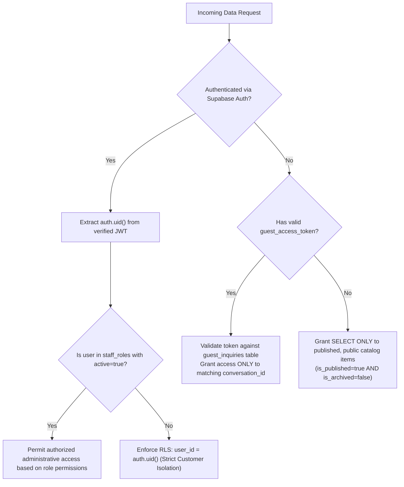

# POM'S Information Security & Privacy Architecture Plan
**Classification:** Proprietary / Production Security Standard  
**Brand:** POM'S International Footwear  
**Project:** `POMS-WEBSITE`  
**Security Lead:** Lead Security Architect

---

## 1. Threat Model & Security Objectives

POM'S operates as an international footwear brand handling proprietary shoe designs, international wholesale pricing, custom quotations, and customer communication. The security model addresses the following core threats:

1. **Cross-Customer Data Leakage (IDOR):** An unauthorized customer attempting to view another customer's bespoke shoe sketches, message threads, or financial quotations.
2. **Privilege Escalation:** A regular customer or unauthenticated visitor accessing `/admin` endpoints, altering product prices, or assigning administrative roles.
3. **Storage Exposure:** Public enumeration or crawling of private customer shoe photos, design sketches, or bank deposit slips.
4. **Credential stuffing & Brute Force:** Automated attacks targeting `/admin/login` or customer accounts.
5. **Cross-Site Scripting (XSS) & Injection:** Malicious inputs submitted via custom design forms or chat messages executing in staff or visitor browsers.
6. **Infrastructure Collateral Risk:** Accidental interference with or leakage into the owner's legacy MSSQUEEN project.

---

## 2. Customer Privacy & Row-Level Authorization (Zero-Trust)

### 2.1 The Customer Isolation Mandate
Under no circumstances may Customer A view, query, or infer records belonging to Customer B. This is enforced at the database kernel level via PostgreSQL Row Level Security (RLS), not merely by hiding frontend UI buttons.

### 2.2 Dual Authorization Flows



### 2.3 Guest Verification Security
Visitors submitting bespoke design inquiries without registering an account receive a cryptographically generated high-entropy access token:
- **Algorithm:** 32-byte cryptographically secure random sequence formatted as a 64-character hexadecimal token (generated using `crypto.randomBytes(32)`).
- **Storage:** Stored in the `conversations.guest_access_token` column with a unique index.
- **Verification:** Verified strictly via server-side Server Actions over HTTPS. Rate-limited to prevent brute-force token enumeration.
- **Expiration & Revocation:** Guest tokens expire after 90 days or upon the customer converting their inquiry into a registered customer profile.

---

## 3. Administrative Portal (`/admin`) Security & RBAC

### 3.1 Hardened Access Control
- **Discreet Route:** The administrative portal is accessible at `/admin`.
- **No Public Registration:** The registration route `/admin/register` does not exist.
- **Initial Bootstrap:** The primary owner account is provisioned once via a protected, single-use server script requiring a secure `BOOTSTRAP_SECRET_KEY` defined in server environment variables.
- **Staff Provisioning:** Subsequent staff members can only be created by an active `owner` or `super_admin` from inside the authenticated `/admin/staff` console.

### 3.2 Role Hierarchy & Separation of Duties
Staff permissions are evaluated on every Server Action and Server Component rendering:

```
[ owner ]
   │── [ super_admin ]
   │── [ product_manager ]   --> Products, Collections, Media, Layout
   │── [ content_manager ]   --> Homepage Editor, Translations, SEO
   │── [ wholesale_manager ] --> Wholesale Quotes, Orders, Packaging
   └── [ customer_support ]  --> Design Inquiries, Customer Messaging
```

### 3.3 Session Management & Cookies
- Authentication tokens are maintained strictly in `HttpOnly`, `Secure`, `SameSite=Lax` cookies managed via `@supabase/ssr`.
- Tokens are inaccessible to client-side JavaScript (`document.cookie`), mitigating XSS session hijacking.
- Admin sessions expire automatically after 8 hours of inactivity, requiring re-authentication.

---

## 4. Cloud Storage Architecture & Access Policies

All uploaded files are organized into dedicated Supabase Storage buckets with strict access policies:

| Bucket Name | Visibility | Allowed MIME Types | Max File Size | Upload Authorization | Read Authorization |
|---|---|---|---|---|---|
| `public-catalogue` | Public CDN | `image/jpeg`, `image/png`, `image/webp` | 8 MB | Authorized Staff (`product_manager`, `owner`) | Public World |
| `private-designs` | Private | `image/jpeg`, `image/png`, `image/webp` | 15 MB | Authenticated Customer or Verified Guest Token | Author & Staff |
| `private-quotations`| Private | `application/pdf`, `image/jpeg`, `image/png` | 20 MB | Staff (`wholesale_manager`) & Customer (Payment Slip) | Transaction Participants |

### 4.1 Private Storage Access via Signed URLs
Files in `private-designs` and `private-quotations` can never be accessed via static public URLs. Access is granted exclusively via short-lived (60 seconds) cryptographically signed URLs generated on-demand by the server after verifying the user's session or guest token.

---

## 5. Rate Limiting, Input Validation & Sanitization

### 5.1 Route Rate Limiting
To defend against credential stuffing, automated spam, and DoS attacks, rate limiting is enforced on sensitive endpoints:
- `/admin/login` — Maximum 5 failed attempts per 15-minute window per IP.
- `/custom-design` — Maximum 3 submissions per hour per IP.
- `/api/messages/send` — Maximum 30 messages per 10-minute window per conversation.
- `/authenticity` — Maximum 15 verification lookups per minute per IP.

### 5.2 Schema Validation
All mutation payloads are validated against strict **Zod** schemas before reaching database operations:
- String length caps (prevents database overflow attacks).
- Strict email & phone format regex validation.
- File magic-number inspection to prevent malicious executable uploads disguised as images.
- Text sanitization striping HTML tags to neutralize Stored XSS in customer messages.

---

## 6. Audit Logging & Administrative Activity Trail

Every administrative mutation is recorded in the immutable `activity_logs` table:
- **Timestamp:** High-precision UTC timestamp.
- **Actor:** UUID of the acting administrator.
- **Action Type:** Explicit enum (e.g., `product.create`, `quotation.send`, `order.status_update`, `staff.role_change`).
- **Entity Reference:** Target table and UUID of the affected record.
- **Audit Payload:** JSON diff capturing before-and-after values for financial, price, and status modifications.
- **Immutability:** Database RLS prevents updating or deleting entries in `activity_logs`.

---

## 7. Environment Secret Management Protocol

```
# Server-Side Only Secrets (NEVER expose to NEXT_PUBLIC_)
SUPABASE_SERVICE_ROLE_KEY=ey...     # Full DB bypass key for server background jobs
ADMIN_BOOTSTRAP_TOKEN=sec_...       # Used once to create owner
AI_TRANSLATION_API_KEY=AIza...      # Server-side translation provider
RESEND_API_KEY=re_...               # Email notification provider

# Public Client-Safe Variables (Safe for browser bundle)
NEXT_PUBLIC_SUPABASE_URL=https://...supabase.co
NEXT_PUBLIC_SUPABASE_ANON_KEY=ey... # Subject to 100% RLS enforcement
NEXT_PUBLIC_SITE_URL=https://poms-shoes.com
```

- **Git Safeguards:** `.gitignore` explicitly prevents committing `.env`, `.env.local`, or any `.pem` certificates.
- **MSSQUEEN Isolation:** Environment variables must use new, independent keys generated for POM'S.
